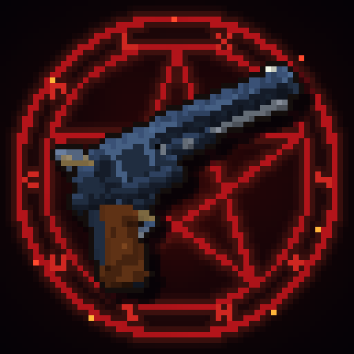

# SupernaturalCraft



A NeoForge 1.21.1 mod inspired by *Supernatural*: hunt demons, compose Enochian sigil spells, draw ritual circles, and fight
your way through 21 bosses, from Azazel and Lucifer's Cage to the Horsemen, the archangels and the Author.

Unofficial fan project, not affiliated with Warner Bros. or The CW. All art, models, sounds and code are original.
The player-facing description (features, requirements) is in [`branding/modrinth.md`](branding/modrinth.md).

## Requirements

- Minecraft 1.21.1, NeoForge 21.1.221+
- GeckoLib 4.9+ (required)
- PlayerAnimationLib 1.1.6+ (required on clients)
- JEI and Curios (optional)
- [Nations & War](https://github.com/pablo-rico/nationsandwar) 0.2+ (optional): guilds become consecrated nations, the Pit,
  the Host and SucroCorp run nations of their own (seat and enclaves), and the chains' wars are fought as Nations & War
  sieges. Without it the chains keep their ring of sectors. Dev runs load it by default (`libs/`); `-PnoNw` runs without it.

## Development

Java 21. The technical guide for the codebase (package map, recipes for adding content, per-system rules, GameTest pitfalls)
is [`CLAUDE.md`](CLAUDE.md).

```bash
./gradlew build                 # compile + JUnit
./gradlew runData               # regenerate src/generated (models, lang, loot, tags, recipes, sounds, worldgen)
./gradlew runGameTestServer     # GameTests
./gradlew runClient
```

### Art, sounds and structures (generated by code, dependency-free Python)

```bash
python3 tools/artgen/generate.py    # textures, GeckoLib models (.geo.json) and animations
python3 tools/artgen/logo.py        # the logo (branding/ and the in-game mod list)
python3 tools/soundgen/generate.py  # synthesized sounds
python3 tools/structgen/empty_template.py
```

Never edit generated PNG/JSON by hand: change the script and regenerate.

### In-game previews

```bash
cp -R runs/gameTestServer/world runs/client/saves/sn_preview
SN_PREVIEW=lucifer1,ritual,arena ./gradlew runClient -Ppreview
```

Screenshots land in `runs/client/screenshots/sn_*.png`; the scene list is in `CLAUDE.md`.

## License

MIT.
